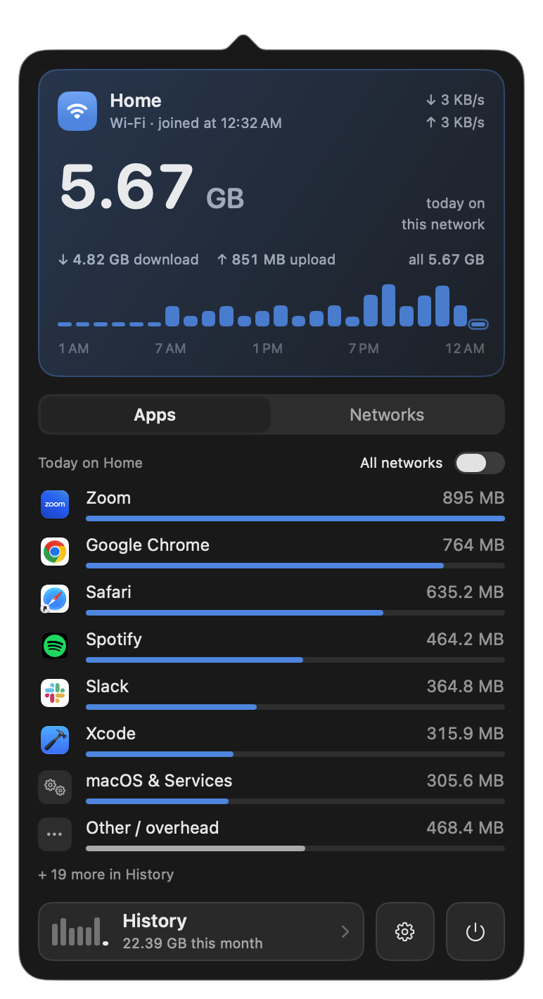
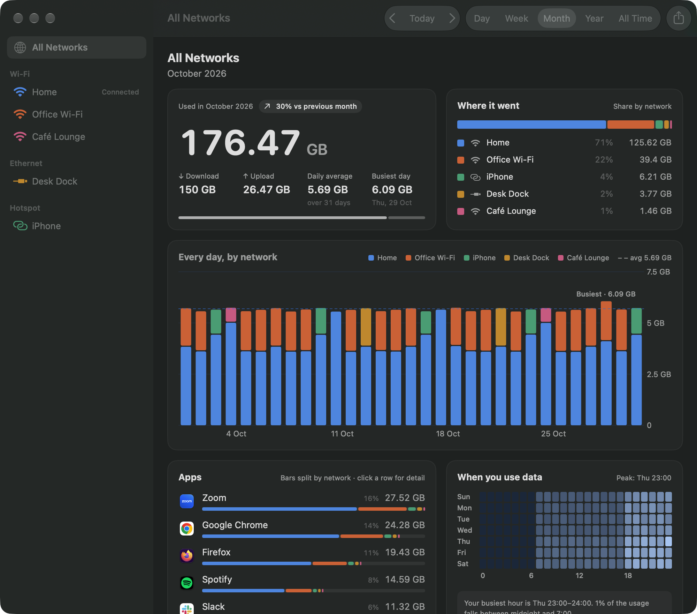
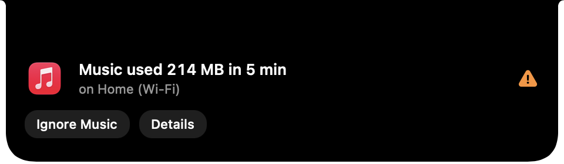

# Soroband

**Know where your data goes: per app, per network, forever.**

[](https://github.com/AboulEinein/soroband/actions/workflows/ci.yml)
[](https://github.com/AboulEinein/soroband/releases/latest)

[](LICENSE)

Soroband is a free, open-source macOS menu bar app that meters your internet usage for every app on every network you join: home Wi‑Fi, the office, a café, your iPhone hotspot. The daily counter starts again each day; the history never does. The name is soroban, the Japanese abacus, plus bandwidth.

<p align="center"></p>

## Why

macOS shows how much data crossed the network, but not which app used it or on which network. That matters when the network is metered: a hotspot on your phone's data plan, a capped connection, a hotel's paid Wi‑Fi. Soroband answers "what used my hotspot data?" after the fact, and keeps the answer for every day since you installed it.

## Features

- **Today at a glance.** The menu bar shows today's usage on the network you're on, or a live speed, or up to four readings at once.
- **Per app and per network.** Which apps used how much, on which network, and how networks compare. Downloads a system service makes for an app (the App Store, Software Update) are credited to that app.
- **History kept forever.** Day, week, month, year and all-time views with a usage chart, the app breakdown, a weekday-by-hour heatmap and CSV export.
- **Hotspot aware.** iPhone hotspots are recognized and metered on their own, so you know what you spent on your phone's data plan.
- **Dynamic Island moments (optional).** Short updates that grow from the notch: network joined or left, a live hotspot meter, an app hogging data, data moving in the background, large transfers.
- **Light.** Soroband reads the kernel's own per-connection byte counters every 5 seconds, and each app's CPU, memory, disk and energy once a minute. With today's total in the menu bar it uses about 0.1% CPU (0.11% measured on a Mac running many apps and agent shells) and 16–18 MB of memory; the windows run in a second process that quits 10 minutes after the last one closes.
- **Scriptable.** The `soroband` command prints usage as tables or JSON and changes every setting, so you or a coding agent can query and configure it from the terminal.
- **Private.** Counters and metadata only: no packet contents, no account, no analytics. Everything stays on your Mac.

<p align="center"></p>

<p align="center"></p>

## Install

Soroband needs macOS 14 (Sonoma) or later. Per-app counting needs macOS 27 for now: Soroband reads the kernel's per-connection records only in the layouts it has seen on a real Mac, and on macOS 14 to 26 it counts each network's total without the per-app breakdown, local-network traffic (a NAS, AirPlay, Time Machine) included.

### Download

1. Download `Soroband.dmg` from the [latest release](https://github.com/AboulEinein/soroband/releases/latest) and open it.
2. Drag **Soroband** to **Applications**, then open it from Applications.
3. Soroband is signed but not notarized by Apple (that needs a paid developer account), so macOS blocks the first launch. Open **System Settings › Privacy & Security**, scroll to Security, click **Open Anyway** next to "Soroband", and confirm. You do this once.
4. Optional, for the `soroband` command: `mkdir -p ~/.local/bin && ln -sf /Applications/Soroband.app/Contents/Helpers/soroband ~/.local/bin/soroband`

Each release lists the SHA-256 checksum of `Soroband.dmg`; `shasum -a 256 Soroband.dmg` prints the one you downloaded.

### With a coding agent

Paste this into Claude Code, Codex, Cursor or any other coding agent:

```text
Install Soroband on this Mac by following https://github.com/AboulEinein/soroband/blob/main/docs/agents/install.md
```

The agent asks which route you want (the release, or a build from source), checks the download's checksum, and walks you through the permissions.

### From source

Needs Xcode and Rust. An app you build yourself opens without the Open Anyway step, and keeps its Location permission across updates.

```sh
git clone https://github.com/AboulEinein/soroband && cd soroband && scripts/install.sh
```

The script builds the app for your Mac, signs it with a certificate it creates on your Mac, installs it into `/Applications` and the `soroband` command into `~/.local/bin`, and launches it.

### Location permission

macOS reveals the Wi‑Fi network's name only to apps with Location access. At the first launch, Soroband asks for it so it can tell your Wi‑Fi networks apart by name; it never stores or sends your location. Without it, Wi‑Fi networks are told apart by their router instead and show as "Wi‑Fi" until you rename them.

### Update

- **Installed from a release:** `soroband update` downloads the newest release, checks its checksum and replaces the app. `soroband update --check` only says whether there is one. Without the command linked, run `/Applications/Soroband.app/Contents/Helpers/soroband update`.
- **Built from source:** `git pull && scripts/install.sh` in your clone.

### Uninstall

Quit Soroband (the power button in its popover), then:

```sh
rm -rf /Applications/Soroband.app ~/.local/bin/soroband
rm -rf ~/Library/Application\ Support/Soroband        # your usage history and settings
```

A build from source also left its signing certificate in `~/Library/Keychains/soroband-signing.keychain-db`; remove it with `security delete-keychain ~/Library/Keychains/soroband-signing.keychain-db`.

## Use

Click the menu bar item for today's usage on this network, the apps that used it and every network's total. **History…** opens the History window; the gear opens Settings, where you choose what the menu bar shows, name and color your networks, and turn on the island.

Everything in Settings is also a `soroband` command, and the running app applies a change at once:

```sh
soroband today                           # today's usage per network
soroband apps --network Home             # today's apps on one network
soroband live                            # internet bytes per app, as they happen
soroband config list                     # every setting with its value and description
soroband config set reset_hour 4         # the daily counter starts at 04:00
soroband today --json                    # every query prints JSON for scripts and agents
```

[`docs/agents/configure.md`](docs/agents/configure.md) lists every setting.

## How it works

A small Rust core subscribes to the macOS kernel's network statistics (`com.apple.network.statistics`), which report the bytes of each connection along with the process that owns it. Soroband keeps only internet traffic on physical interfaces (Wi‑Fi, Ethernet, cellular; on macOS 14 to 26, which count network totals only, local-network traffic stays in), credits each connection to its app, and books the bytes to the network the Mac was on. Totals are stored per hour, per network and per app in a local SQLite database in `~/Library/Application Support/Soroband`, and each network's total comes from the interface counters: what apps cannot account for (packet headers, system traffic) shows as "Other / overhead".

The menu bar app is AppKit and SwiftUI, linked to the Rust core. The design, the measurements behind it and the performance budget are in [`docs/design.md`](docs/design.md).

## Privacy

Soroband reads byte counters, process names and the network's name. It never reads packet contents, has no account and never sends your usage anywhere. The only time it connects to anything itself is `soroband update`, when you run it, to download the newest release from GitHub. See [`SECURITY.md`](SECURITY.md).

## Contributing

Bug reports, ideas and pull requests are welcome: see [`CONTRIBUTING.md`](CONTRIBUTING.md), which covers building, testing and the project's rules. Report security issues privately, as [`SECURITY.md`](SECURITY.md) describes. Changes are listed in [`CHANGELOG.md`](CHANGELOG.md).

| Path | Contents |
| --- | --- |
| `app/` | The menu bar app (AppKit and SwiftUI) |
| `core/` | The Rust core (meter engine, storage, settings) and the `soroband` command |
| `docs/` | Design, install guides for agents, and the project's working records ([`docs/README.md`](docs/README.md)) |
| `prototypes/` | Throwaway code that settled the design |
| `scripts/` | Build, install, packaging and verification scripts |

## License

[MIT](LICENSE)
