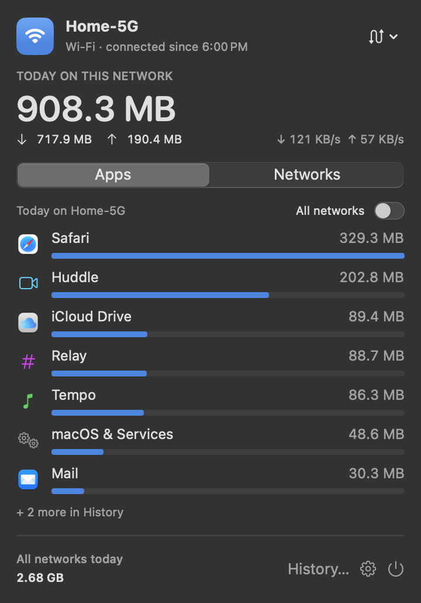
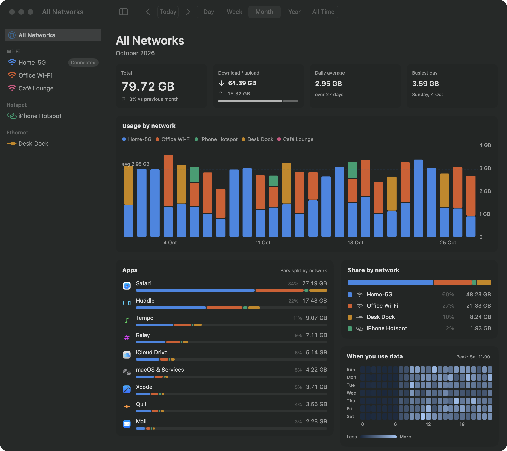
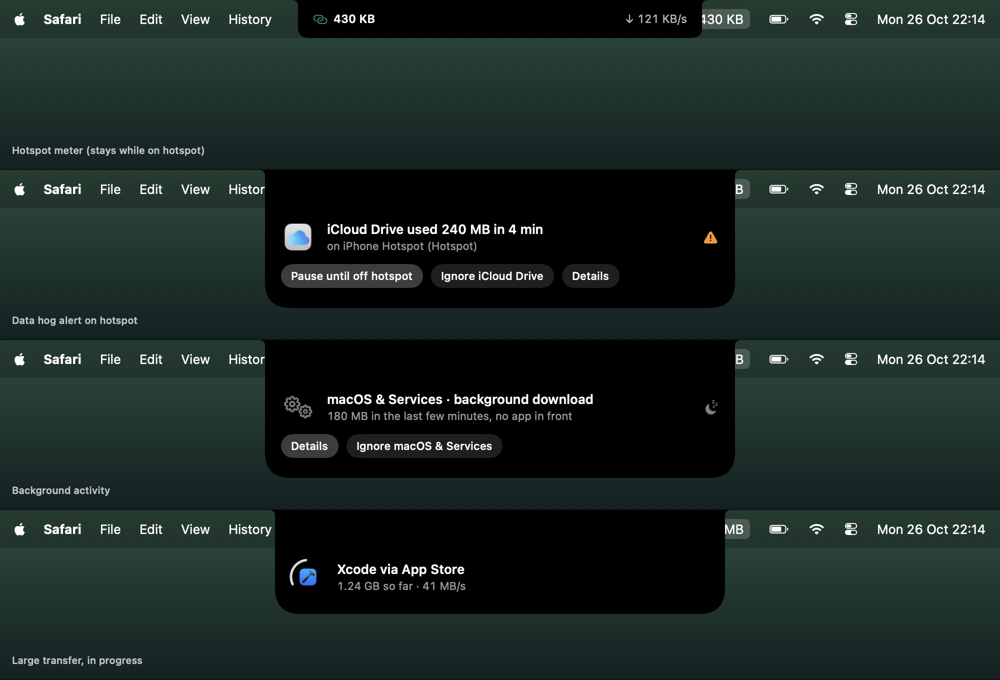

# Soroband

**Know where your data goes: per app, per network, forever.**

The name: soroban, the Japanese abacus, plus bandwidth.

Soroband is a macOS menu bar app that meters your internet usage for every app on every network you join: home Wi‑Fi, the office, a café, your iPhone hotspot. The daily counter resets each day; the history never does.

> **Status:** in development, no release yet. Screenshots below are from the UI prototype. Progress is tracked in [`docs/plan.md`](docs/plan.md).



## Features

- **Today at a glance.** The menu bar shows today's usage on the network you're on.
- **Per app and per network.** See which apps used how much, on which network, and how that compares across networks.
- **History kept forever.** Day, week, month, year and all-time views with a usage chart, app breakdown and a weekday-by-hour heatmap.
- **Hotspot aware.** Hotspots are recognized and metered on their own, so you know exactly what you spent on your phone's data plan.
- **Dynamic Island moments (optional).** Short updates that grow from the notch: network joined or left, a live hotspot meter, an app hogging data, data moving in the background, large transfers.
- **Accurate and light.** Soroband reads the kernel's own per-connection byte counters. The prototype engine costs about 0.05% CPU and 2 MB of memory.
- **Agent friendly.** Install, configure and query it from any coding agent: a published install prompt, `soroband config` for every setting, JSON output for every query.
- **Private.** Counters and metadata only: no packet inspection, no account, no network requests. Everything stays on your Mac.





## Install

Soroband needs macOS 14 or later. The steps below work from v0.1.0 on.

**Download:** get `Soroband.dmg` from the [latest release](https://github.com/AboulEinein/soroband/releases/latest) and drag Soroband to Applications. Soroband is free and not notarized by Apple, so the first launch is blocked once: open **System Settings › Privacy & Security** and click **Open Anyway** next to Soroband.

**With a coding agent** (Claude Code, Codex, Cursor and others), paste:

```text
Install Soroband on this Mac by following https://github.com/AboulEinein/soroband/blob/main/docs/agents/install.md
```

The agent installs the latest release and handles the first-launch approval with you.

**From source** (needs Xcode and Rust; an app you build yourself opens without the approval step):

```sh
git clone https://github.com/AboulEinein/soroband && cd soroband && scripts/install.sh
```

Run `scripts/install.sh` again to update.

## Configure

Everything in Settings is also available from the terminal, so you or an agent can change it:

```sh
soroband config list                     # every setting with its value and description
soroband config set reset_hour 4         # the daily counter starts at 04:00
soroband today --json                    # usage queries print JSON for scripts and agents
```

## How it works

A small Rust core subscribes to the macOS kernel's network statistics, which report bytes per connection along with the owning process. Soroband keeps only internet traffic on physical interfaces (Wi‑Fi, Ethernet, cellular), credits each connection to its app (including downloads a system service performs on an app's behalf), and books the bytes to the network you were on. Totals are stored per hour, per network and per app in a local SQLite database.

Details: [`docs/design.md`](docs/design.md).

## Project layout

| Path | Contents |
| --- | --- |
| `app/` | SwiftUI menu bar app |
| `core/` | Rust core: meter engine, storage, `soroband` CLI |
| `docs/` | Design, plan, mockups |
| `prototypes/` | Throwaway code that settled the design |

## Contributing

See [`CONTRIBUTING.md`](CONTRIBUTING.md). Security issues: [`SECURITY.md`](SECURITY.md).

## License

[MIT](LICENSE)
